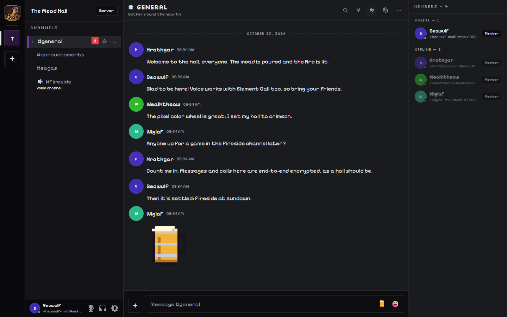
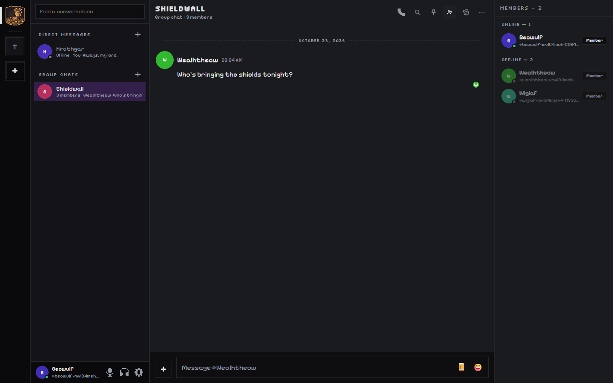
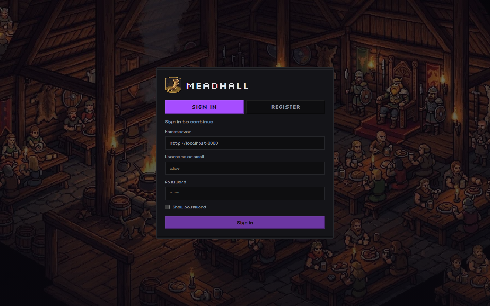
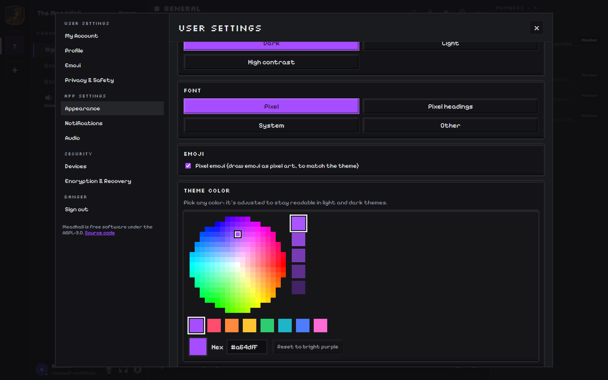

<div align="center">


# Meadhall

**A pixel-art, Discord-style chat app on the open Matrix protocol.**
Servers, channels, voice hangouts and stickers, end-to-end encrypted and self-hostable, and it talks to Element users too.

[](https://github.com/PeytonG/Meadhall/actions/workflows/ci.yml)
[](https://github.com/PeytonG/Meadhall/actions/workflows/security.yml)
[](https://github.com/PeytonG/Meadhall/releases)
[](LICENSE)

[Download](#download) · [Features](#features) · [Self-hosting](docs/self-hosting.md) · [Development](#development) · [Security](SECURITY.md)



</div>

## Features

**Feels like Discord**
- Spaces are servers, rooms are channels, with categories, drag-and-drop channel order and per-channel settings.
- **Home**: the Meadhall icon opens your **Direct Messages**, with **Group Chats** under them, with presence, unread
  counts and who's in a call.
- **Calls in DMs and group chats**: press the phone button (or **Call** on someone's profile). Nobody has to answer;
  the others get a notification (never a ring) and a "Join call" bar.
- Voice channels are **persistent hangouts**: click to join, no ringing and no "answering". A call stays open as long as anyone is in it.
- Bottom-left user panel with mute, deafen and settings. Mute and deafen work **any time**, in or out of a call,
  and you join calls the way you left them. A "Voice Connected" panel shows while you're in a call.
- Replies, edits, reactions, pinned messages, read receipts, typing indicators, date dividers, and an online/offline member list.
- **Roles and permissions** like Discord: colored roles with permissions, and channels private to certain roles. They
  work as Matrix power levels, so the server enforces them for everyone.
- **Incoming calls ring** with an 8-bit Meadhall ringtone, for the person being called only.

**Pixel art everywhere**
- A hand-made pixel theme with pixel fonts, sprite borders and pixel icons. Bright purple by default, and the
  **pixel color wheel** (Settings → Appearance) recolors the whole app, readable in light and dark.
- Fonts: Pixel, Pixel headings, System, or **any font installed on your device**. Profile pictures are round.
- **Pixel stickers** you can drop into any chat, plus custom emoji packs per server and per person.
- **Pixel emoji** (on by default) and a pixel **campfire** that flickers above whoever is talking, in their color.

**Voice that works with Element**
- Voice uses **MatrixRTC with LiveKit**, the same as Element Call, so Meadhall and Element users share calls.
- Media is **end-to-end encrypted** in encrypted rooms.
- Change your microphone, speaker, noise suppression or echo cancellation **mid-call**, with no leaving and rejoining.
- **Voice changer** (Giant, Pixie, Robot, Great hall, Radio, Troll): everyone hears it, Element users included, and
  you can switch mid-call or try it first with "Hear yourself" in Settings → Audio.
- Screen sharing, per-person volume **up to 120%** for quiet mics, and system audio capture on Windows.

**Private and yours**
- End-to-end encryption by default (Matrix Rust crypto), device verification, key backup and recovery.
- No analytics, no telemetry. Run it on your own server or sign in to any Matrix homeserver.

**Everywhere**
- Web, Windows, Linux (AppImage and Fedora .rpm) and Android. The desktop app sits in the tray, can start at
  login, and **updates itself**: a notification offers "Update now", then downloads, installs and restarts.
- **Notifications** on desktop (even from the tray) and on Android in the background, with no Google account or
  extra app needed.
- Server admins get a **Server admin** panel in Settings: invite tokens, new accounts, password resets.
- On phones it works like the Discord app: the server rail and conversation list on one screen, the chat on the
  next, and Back takes you back.

<details>
<summary><b>More screenshots</b></summary>









</details>

## Download

Get the latest version from **[Releases](https://github.com/PeytonG/Meadhall/releases/latest)**.

| Platform | File | Install |
|---|---|---|
| **Windows** 10/11 | `Meadhall-Setup-<version>.exe` | Run the installer. Windows SmartScreen may warn because the app isn't code-signed yet: choose **More info → Run anyway**. |
| **Linux** (any distro) | `Meadhall-<version>-x86_64.AppImage` | `chmod +x Meadhall-*.AppImage`, then run it. |
| **Fedora / RHEL** | `Meadhall-<version>-x86_64.rpm` | `sudo dnf install ./Meadhall-*.rpm` |
| **Android** 7+ | `Meadhall-<version>-android.apk` | Open the APK on your phone and allow installing from your browser or file manager when asked. |
| **Web** | — | Use a Meadhall someone hosts, or [host your own](docs/self-hosting.md). |

Every release includes `SHA256SUMS.txt` so you can verify downloads. Desktop apps update themselves from here.

### First steps

1. Sign in with any Matrix account, or register one. The homeserver defaults to `https://matrix.org`; type your
   own server's address to use it. If a server needs a **registration token** (an invite code from its admin), the
   Register form asks for it (see [Signing up](#signing-up)).
2. A fresh account may offer to set up **secure backup**. Do it, and keep the key safe: it unlocks your encrypted
   history on new devices.
3. Create a space with **+** in the left rail, add text and voice channels, and invite friends.
4. Click a voice channel to join. Use the gear in the voice panel or **Settings → Audio** for devices.

## Self-hosting

Meadhall is a static web app that talks to a Matrix homeserver. For the full setup (homeserver, the web app, and
the LiveKit voice backend shared with Element Call), see **[docs/self-hosting.md](docs/self-hosting.md)**.

Quick version for the web app:

```bash
git clone https://github.com/PeytonG/Meadhall.git && cd Meadhall
pnpm install
cp apps/web/config.example.json apps/web/config.json   # point default_server_config at your homeserver
pnpm build:web                                         # static files in apps/web/dist/ (serve with any web server)
```

## Development

**Requirements:** Node.js 22+, pnpm 10, and Docker for the integration and end-to-end tests.

```bash
pnpm install
pnpm dev:web                 # web app at http://localhost:5173
pnpm dev:desktop             # Electron desktop app
pnpm typecheck
pnpm --dir apps/web test     # unit tests
```

| Tests | Command | What it covers |
|---|---|---|
| Unit | `pnpm --dir apps/web test` | Logic: voice/MatrixRTC helpers, theme engine, stickers, updates UI and more |
| Smoke | `pnpm --dir apps/web test:smoke` | The voice room component with a simulated call (E2EE, live audio settings) |
| Integration | `node scripts/test-synapse.mjs start` then `pnpm --dir apps/web test:integration` | Real Synapse (room versions 11 and 12): imports, MatrixRTC memberships, encrypted key exchange |
| End-to-end | `pnpm --dir apps/web test:e2e` (Synapse running) | The real app in Chromium: sign-in, chat, stickers |

All of these run on every push in [GitHub Actions](.github/workflows/ci.yml), alongside
[security scanning](.github/workflows/security.yml) (CodeQL, dependency review, gitleaks, `pnpm audit`,
Electronegativity).

| Path | What's there |
|---|---|
| `apps/web` | The app: React 19, Vite, matrix-js-sdk, LiveKit |
| `apps/desktop` | Electron wrapper: tray, updates, permissions |
| `apps/mobile` | Android app (Capacitor) |
| `branding/`, `scripts/generate-branding.mjs` | Source artwork and the script that makes every icon from it |
| `scripts/generate-stickers.mjs` | The pixel sticker sprites |
| `CLAUDE.md` | Architecture notes, decisions and their reasons, for humans and AI agents |

**Releasing** (maintainers): push a tag like `v0.2.0`. The [release workflow](.github/workflows/release.yml)
builds Windows, Linux and Android, attaches them to a GitHub Release with checksums, and publishes it once every
build has succeeded. For a release-signed APK, set the `ANDROID_KEYSTORE_*` secrets described in the workflow.

## Known limitations

- **Alpha**: features and settings are still evolving, and there may be breaking changes between versions.
- **Push notifications** aren't implemented: you're notified while the app is open (desktop keeps running in the tray).
- **Calls across homeservers**: Meadhall joins the voice server (SFU) of its own homeserver. Element users who
  publish on a different homeserver's SFU can hear you, but you won't hear them yet (multi-SFU is on the roadmap).
- **Voice needs UDP** access to LiveKit (or a TURN server); it can't go through an HTTP proxy.
- The Windows and macOS apps aren't code-signed yet, and there's no iOS app.

## Roadmap

- Multi-SFU calls (hear Element users on any homeserver)
- Push notifications
- iOS
- More sticker packs, and custom sticker packs per server

## Contributing

Issues and pull requests are welcome. Read **[CONTRIBUTING.md](CONTRIBUTING.md)** first. Please report security
issues privately as described in **[SECURITY.md](SECURITY.md)**.

## Credits and license

Meadhall is a fork of **[Heorot](https://github.com/Vitosicz/Heorot)** by Vitosicz. Heorot is the great mead-hall
in *Beowulf*, hence the name. Parts of Heorot derive from [Element Web](https://github.com/element-hq/element-web).
Meadhall stays compatible with Heorot: servers, categories, voice channels and emoji use the same Matrix event
types, so users of both apps can share a space. See [NOTICE](NOTICE) for what this fork changed.

Licensed under the **[GNU AGPL-3.0](LICENSE)**. If you host a modified Meadhall for others, you must offer them its
source (set `source_code_url` in `config.json`). Fonts: Pixelify Sans and Silkscreen (SIL Open Font License).
