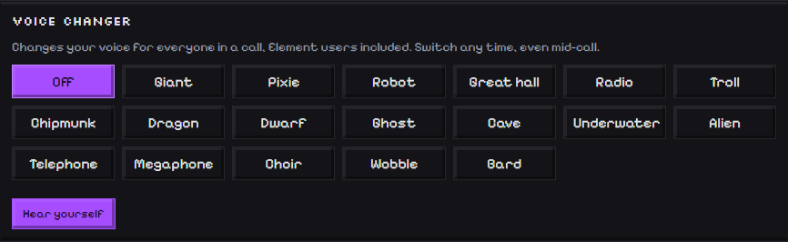
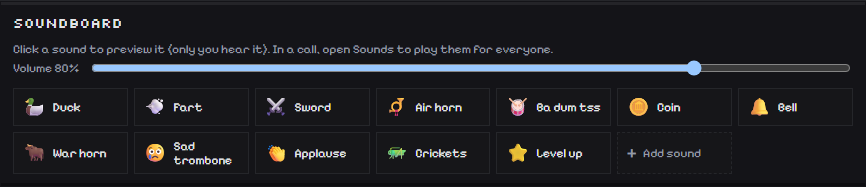
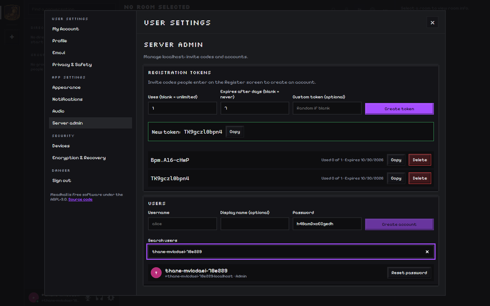

# Meadhall screenshots

Every screenshot here is made by the end-to-end tests against a real Matrix server
(`CAPTURE_SCREENSHOTS=1 pnpm --dir apps/web exec playwright test screenshots`), so they show the app as it is.
Click any image for the full size. **[← Back to the README](../README.md)**

## Chat

**A server:** channels on the left (text and voice), the conversation with a pixel sticker, and the member list in
role colors, with each person's status (the 📱 is someone on the phone app, red is Do Not Disturb).

**Home:** direct messages and group chats, with unread counts.

**Direct messages:** under each name, their status (or what they're playing) and the latest message.

## People

**Profiles:** a banner (image or GIF), About me, links, and the person's roles in every server you share.

**Status:** click your name in the bottom-left corner for a custom status, Online / Away / Do Not Disturb /
Invisible, switching accounts, and adding another account.

## Voice

**Speaking campfire:** a pixel fire burns around whoever is talking, in the color they picked. Prefer something
quieter? Turn it off for a simple ring.

**Voice changer:** 18 effects everyone in the call hears, Element users included. Try them with **Hear yourself**.

**Soundboard:** 12 built-in 8-bit sounds and up to 24 of your own. Preview them in Settings; in a call, open
**Sounds** to play them for everyone.

## Servers and roles

**Roles:** name, color, rank and moderation powers. Roles are Matrix power levels, so the server enforces them.

**Channel access:** for each channel, who can talk (everyone, or a role and above) and who can see it.

## Look and feel

**Light theme.**

**High contrast:** pure black and white with bold outlines; every piece of text is at least 7:1 (WCAG AAA).

**Pixel color wheel:** recolor the whole app; Meadhall keeps whatever you pick readable.

**Pixel stickers.**

## Signing up and admin

**Sign in** to any Matrix homeserver.

**Sign up** on a server that uses invite codes (registration tokens). See
[Signing up](../README.md#signing-up) for every kind of server.

**Server admin panel:** invite codes, new accounts, password resets and admin rights, for server admins only.

## Phone

**On your phone:** your conversations on one screen, the chat on the next. Swipe right to go back, and the send
button sits next to the emoji button.
